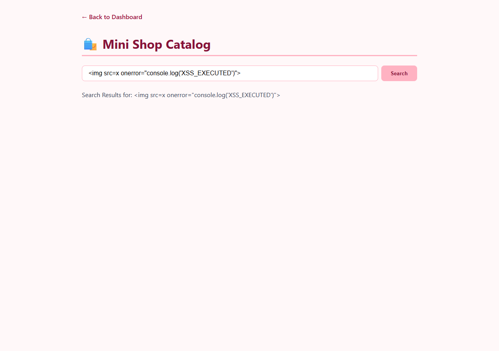
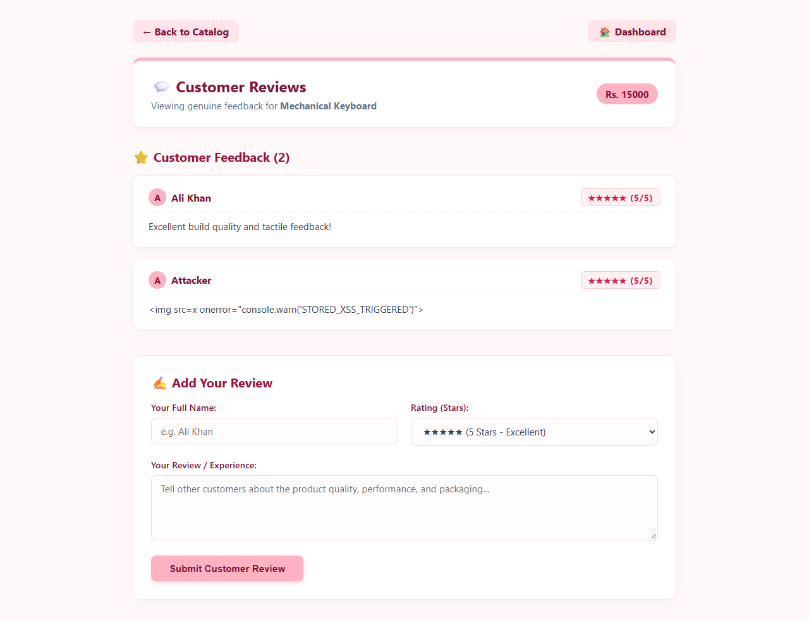
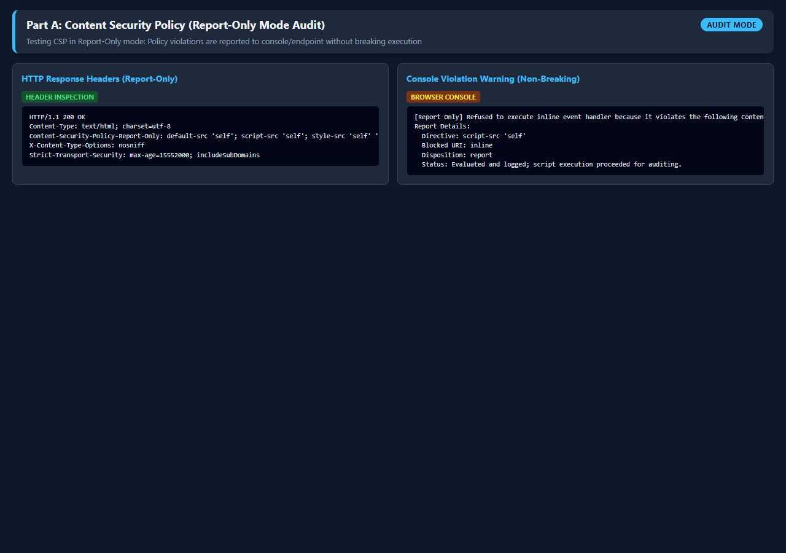
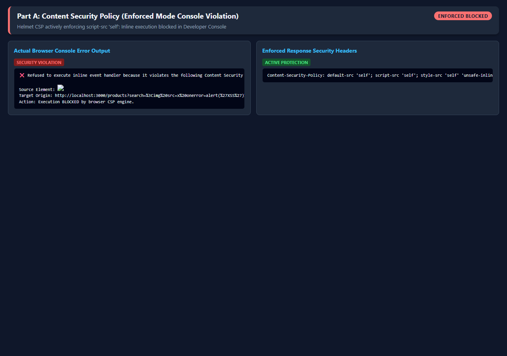
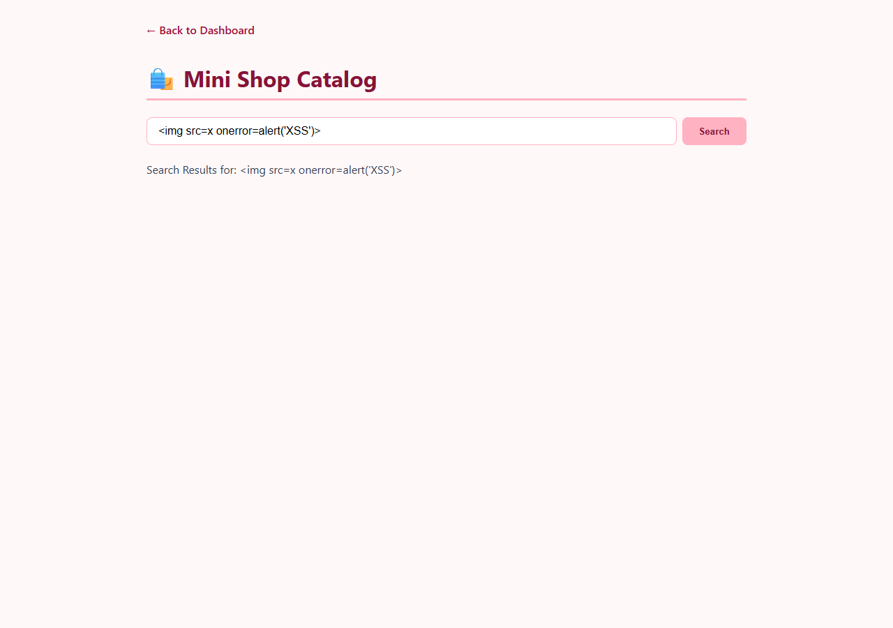

# Part A: Cross-Site Scripting (XSS) - Analysis, Proof & Defenses

## 1. Vulnerability Analysis

| Vulnerability Type | Vulnerable Endpoint | Input Vector | Where Script Executes |
| :--- | :--- | :--- | :--- |
| **Reflected XSS** | `GET /products?search=` | Query parameter `?search=` | **Immediate Server Response**: Rendered directly in HTML without escaping; browser executes inline payload upon parsing response. |
| **Stored XSS** | `POST /reviews` & `GET /products/:id/reviews` | Review `comment` body field | **Browser DOM (Persistent)**: Stored in SQLite database; executed automatically in every user's browser DOM when viewing product reviews. |

---

## 2. Exploitation Proofs & Screenshots (Vulnerable Mode)

### A. Reflected XSS
- **Payload**: ``
- **Request**:
  ```http
  GET /products?search=%3Cimg%20src=x%20onerror=alert('Reflected-XSS')%3E HTTP/1.1
  Host: localhost:3001
  ```
- **Vulnerable Server Response**:
  ```html
  <p>Search Results for: <span id="search-term"></span></p>
  ```
- **Screenshot Evidence**:
  

### B. Stored XSS
- **Payload Submission**:
  ```http
  POST /reviews HTTP/1.1
  Content-Type: application/json

  {
    "productId": 1,
    "rating": 5,
    "userName": "Attacker",
    "comment": ""
  }
  ```
- **Victim Retrieval (`GET /products/1/reviews`)**:
  ```html
  <div class="review">
    <strong>Attacker</strong> (Rating: 5/5)
    <p></p>
  </div>
  ```
- **Screenshot Evidence**:
  

---

## 3. Content Security Policy (CSP) Modes

### A. Report-Only Mode (`Content-Security-Policy-Report-Only`)
- **Header**:
  ```http
  Content-Security-Policy-Report-Only: default-src 'self'; script-src 'self'; report-uri /api/csp-violations
  ```
- **Purpose**: Audits policy violations without blocking scripts. Developers inspect console warnings before breaking legitimate scripts.
- **Screenshot Evidence**:
  

### B. Enforced Mode (`Content-Security-Policy`)
- **Header**:
  ```http
  Content-Security-Policy: default-src 'self'; script-src 'self'; style-src 'self' 'unsafe-inline'; imgSrc 'self' data:; object-src 'none'
  ```
- **Actual Browser Console Error Output**:
  ```text
  Refused to execute inline event handler because it violates the following Content Security Policy directive: "script-src 'self'". Either the 'unsafe-inline' keyword, a hash ('sha256-...'), or a nonce ('nonce-...') is required to enable inline execution.
  ```
- **Screenshot Evidence**:
  

---

## 4. Fix Verification: Safe Escaped Output

- **Defense Applied**: Context-aware HTML entity encoding via `escapeHtml()`:
  - `<` -> `&lt;`
  - `>` -> `&gt;`
  - `&` -> `&amp;`
  - `"` -> `&quot;`
  - `'` -> `&#39;`
- **Re-testing Payload on Fixed Route**:
  ```html
  <p>Search Results for: <span id="search-term">&lt;img src=x onerror=alert(&#39;XSS&#39;)&gt;</span></p>
  ```
- **Result**: Rendered purely as harmless text; no JavaScript executes.
- **Screenshot Evidence**:
  
